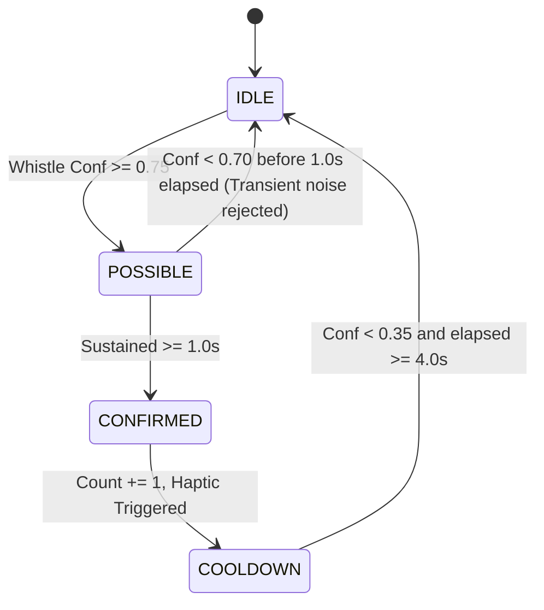

# Pressure Cooker Whistle Counter Android App — Specification

**Date**: 2026-11-06  
**Status**: Approved  
**Package**: `com.whistl.app`  
**Location**: `android/`  

---

## 1. Overview & Goals
The **Whistl Android App** is a native Kotlin application designed to run in kitchens to automatically detect and count pressure cooker whistles in real-time. When a user-configured target whistle count is reached, the app rings a continuous loud alarm and vibrates to alert the cook to turn off the stove.

The app must reliably run in the background (even when the phone is locked or on a table) using an Android Foreground Service with microphone permissions and wake-lock management.

---

## 2. Machine Learning & Audio Architecture

### 2.1 Model Pipeline
* **Backbone**: Google YAMNet feature extractor.
* **Head**: Custom Dense neural network trained on pressure cooker whistles vs. kitchen background noise (`dataset_norm`).
* **Artifact**: `whistle_detector_end_to_end.tflite` (~15.5 MB).
  * **Input**: 1-D Tensor `waveform` of shape `[15600]`, `float32` sampled at 16,000 Hz mono (representing ~0.975s audio snippet normalized between $[-1.0, 1.0]$).
  * **Output**: Tensor `[2]` `float32` containing probabilities:
    * Index 0: `background`
    * Index 1: `whistle`
* This end-to-end model is exported and placed into `android/app/src/main/assets/whistle_detector_end_to_end.tflite`.

### 2.2 Audio Ingestion (`AudioRecorderSource`)
* Uses Android's `AudioRecord` configured for:
  * Audio Source: `MediaRecorder.AudioSource.VOICE_RECOGNITION` (preferred over default MIC to minimize automatic aggressive noise cancellation artifacts on frequency spectra).
  * Sample Rate: 16,000 Hz.
  * Channel: `AudioFormat.CHANNEL_IN_MONO`.
  * Encoding: `AudioFormat.ENCODING_PCM_16BIT`.
* Audio is continuously read into a circular ring buffer sized at 15,600 samples ($0.975\text{s}$).
* Inference is dispatched every 400ms on the latest 15,600 samples.

---

## 3. Whistle Counting State Machine (`WhistleStateMachine`)

### 3.1 Debounce & Cooldown Logic
A pressure cooker whistle is a continuous acoustic event releasing steam over 1.5 to 6 seconds. To prevent single whistles from triggering multiple counts, state transitions are managed as follows:

* **Parameters**:
  * `CONFIDENCE_THRESHOLD`: 0.75
  * `MIN_WHISTLE_DURATION_MS`: 1,000 ms
  * `COOLDOWN_DURATION_MS`: 4,000 ms
  * `COOLDOWN_EXIT_THRESHOLD`: 0.35

---

## 4. Android System Components

### 4.1 Foreground Service (`WhistleDetectionService`)
* **Foreground Service Type**: `microphone`.
* **Wake Lock**: Acquires `PowerManager.PARTIAL_WAKE_LOCK` while actively listening to keep the CPU awake with the screen off.
* **Notification Channel**: `whistl_listening_channel` (Importance: Low, silent).
  * Persistent notification title: *"Whistl — Listening for Cooker Whistles"*
  * Content: *"Whistles: 2 / 4 • Live"*
  * Action buttons: *"Stop"* and *"Reset"*.
* **Alarm Notification Channel**: `whistl_alarm_channel` (Importance: High).
  * Full screen intent / heads-up notification with sound & vibration when target is reached.

### 4.2 Alarm & Feedback Controller (`AlarmController`)
* When `currentCount == targetCount`:
  * Plays alarm ringtone via `RingtoneManager.getActualDefaultRingtoneUri(context, RingtoneManager.TYPE_ALARM)` using `AudioAttributes.USAGE_ALARM`.
  * Triggers repeating vibration pattern `[0, 500, 250, 500]`.
  * Emits event to UI to show a full-screen completion dialog.

---

## 5. User Interface (Jetpack Compose & Material 3)

### 5.1 Main Screen Features
* **Status Card / Waveform Indicator**:
  * Displays current listening state (Idle / Listening / Whistling / Target Reached).
  * Real-time confidence bar and audio activity visualizer.
* **Target Whistle Selector**:
  * Stepper controls (`-` / `+`) and preset chips (1, 2, 3, 4, 5 whistles).
* **Count Ring / Progress**:
  * Large circular progress display showing `Current / Target` (e.g. `2 / 3`).
* **Session Control Button**:
  * Prominent Start / Stop Listening FAB/Button.
* **Whistle Event Timeline**:
  * List of logged whistles with exact timestamps (e.g., *"Whistle 1: 11:20:15 AM"*).

---

## 6. Permissions & Compatibility
* `RECORD_AUDIO` (Runtime permission request).
* `POST_NOTIFICATIONS` (Android 13+ runtime permission).
* `FOREGROUND_SERVICE` & `FOREGROUND_SERVICE_MICROPHONE`.
* `WAKE_LOCK` & `VIBRATE`.
* Min SDK: 26 (Android 8.0).
* Target SDK: 34 / 35.

---

## 7. Testing & Verification Plan
1. **Unit Tests**:
   * `WhistleStateMachineTest`: Simulate sequences of probabilities (noise bursts, valid 2s whistles, multiple close spikes) to verify exact count increments and debouncing.
   * `RingBufferTest`: Verify thread-safe push and pull of float arrays.
2. **Model Integration Test**:
   * Verify model loading in Kotlin and run inference on bundled test WAV audio sample from `dataset/whistle`.
3. **Build & APK Assembly**:
   * Compile and package release/debug APK via Gradle using SDK in `/home/naseem/Android/Sdk`.
